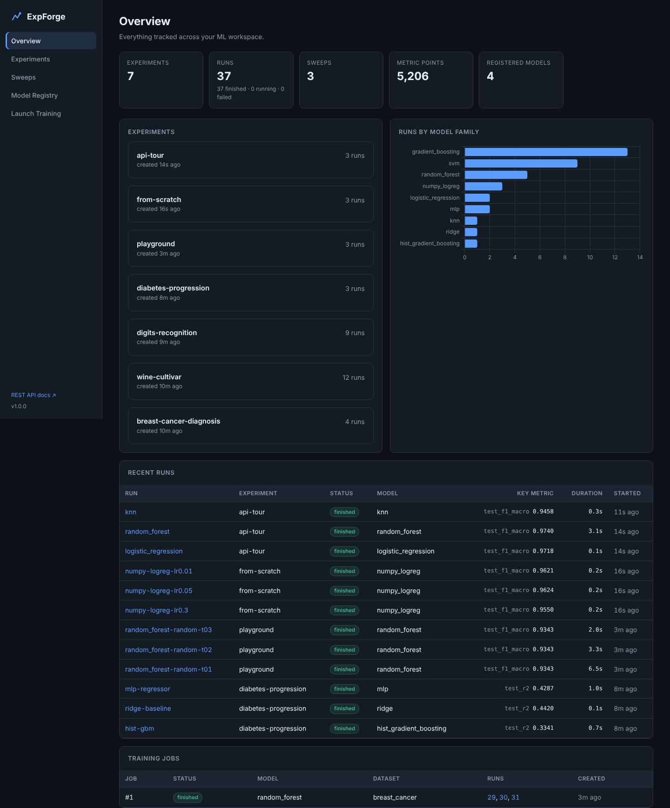
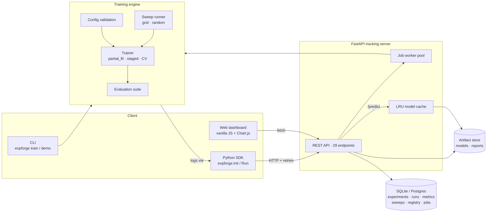
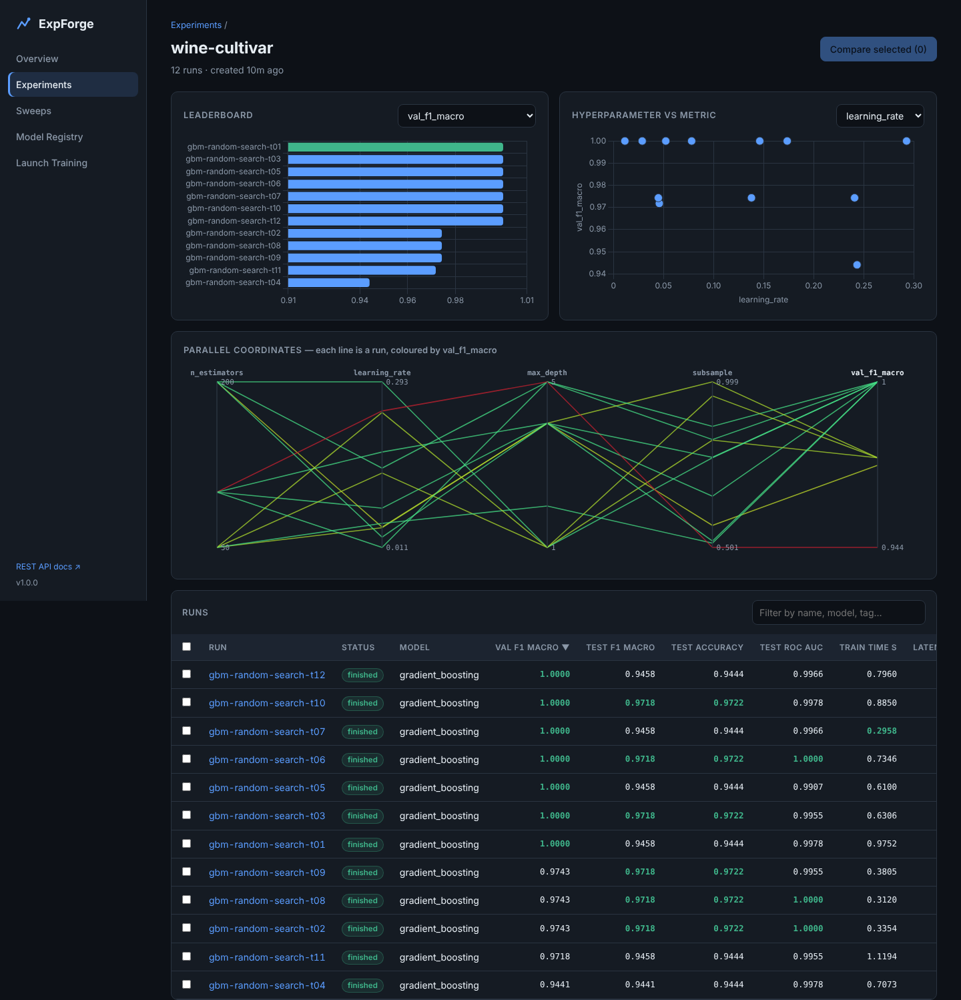
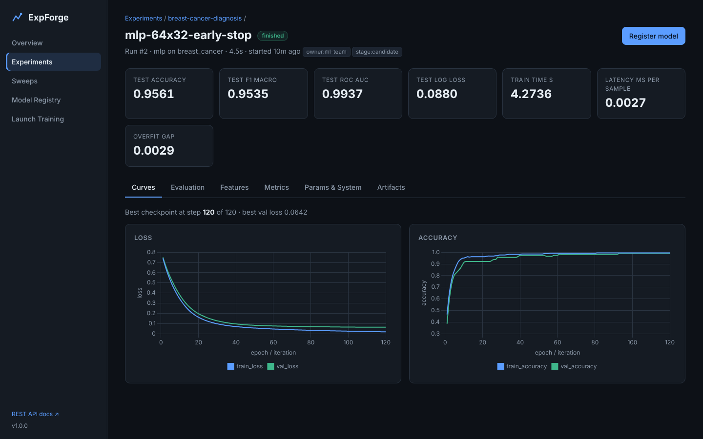
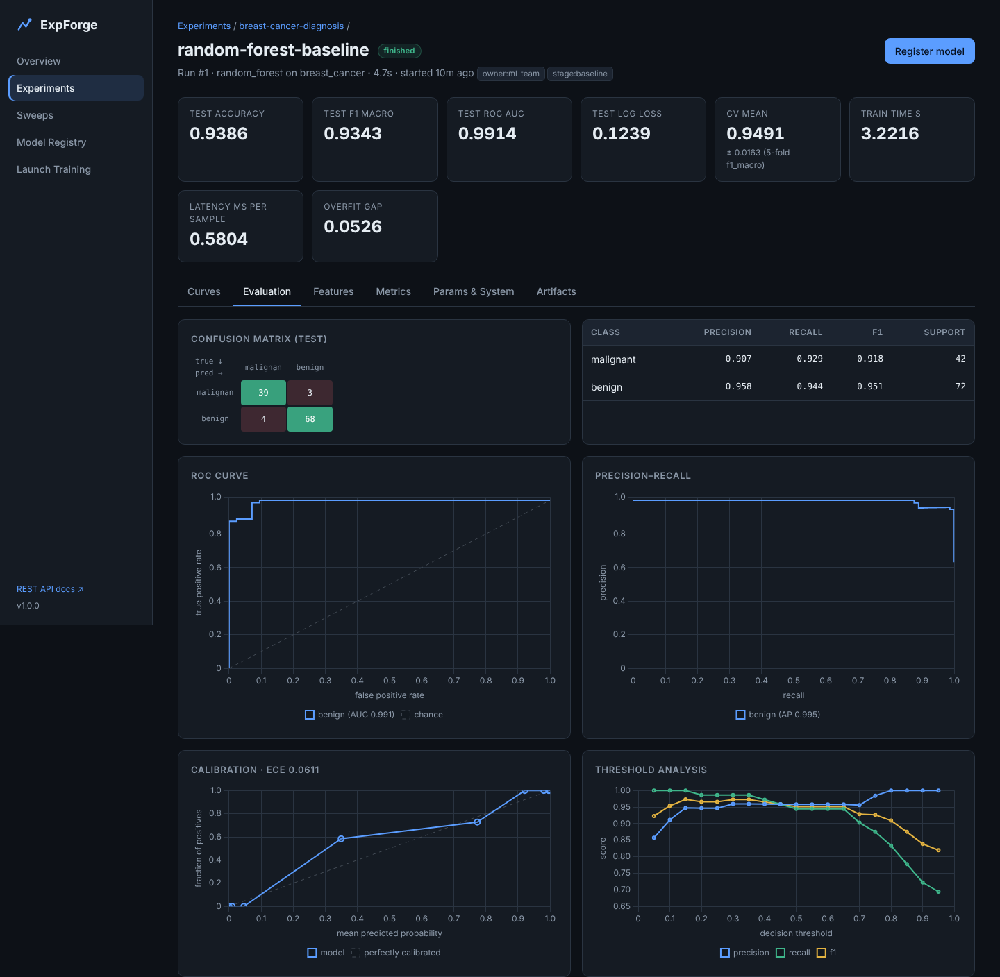
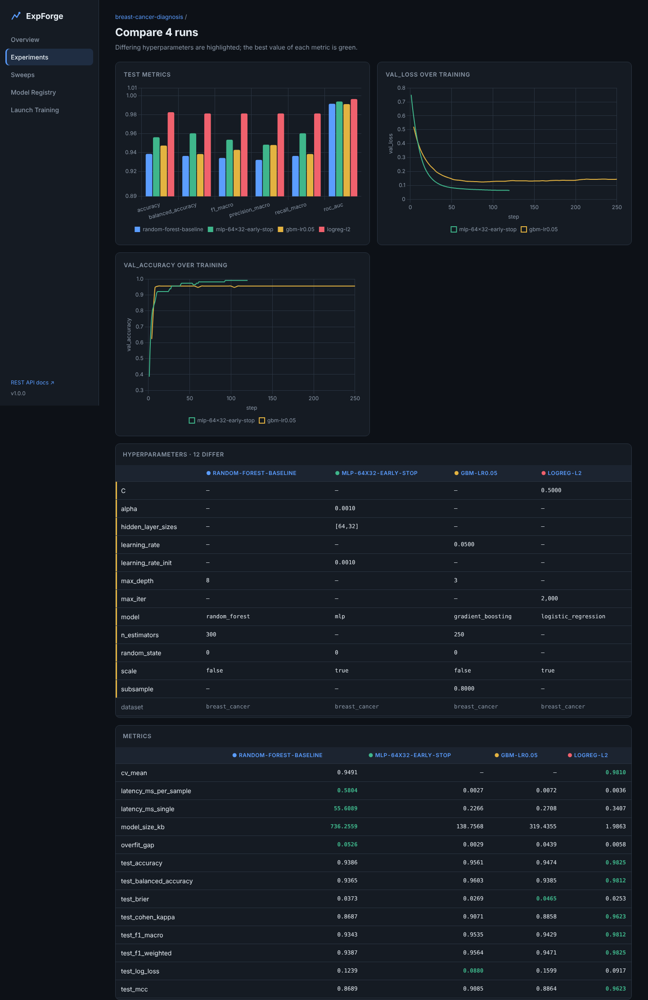
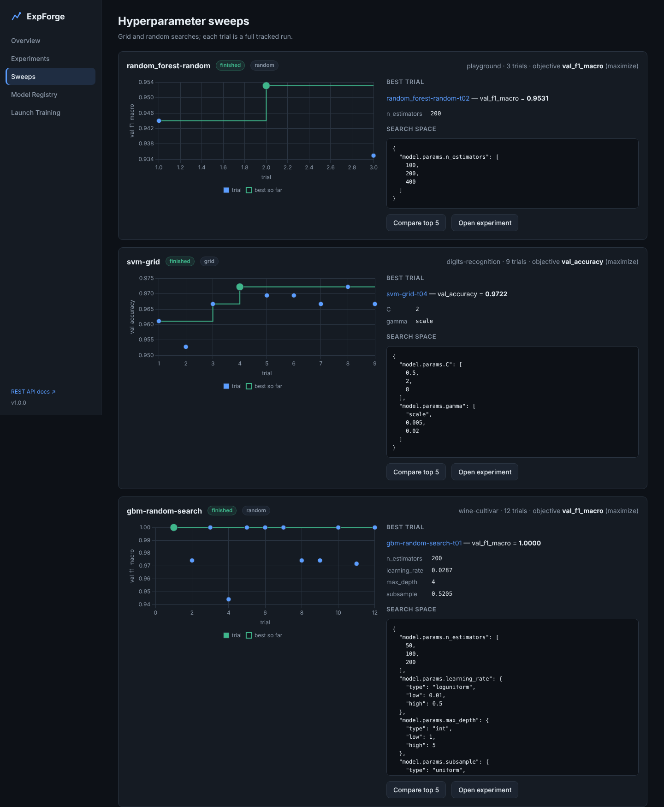
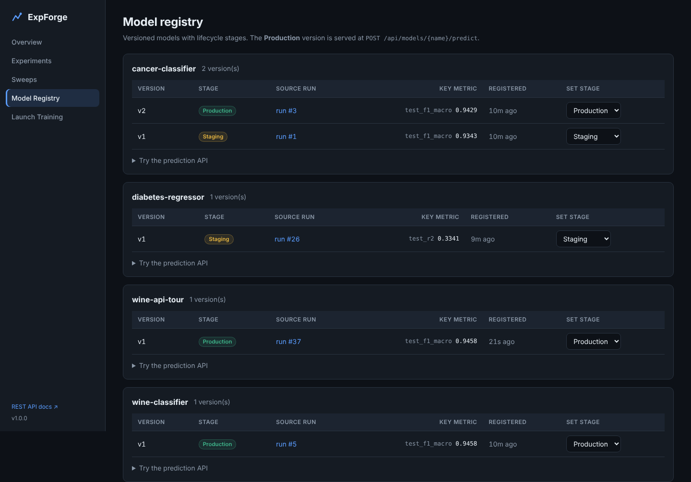
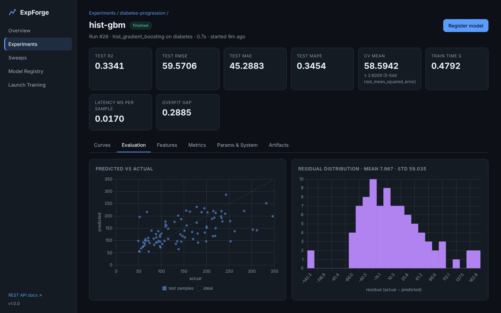
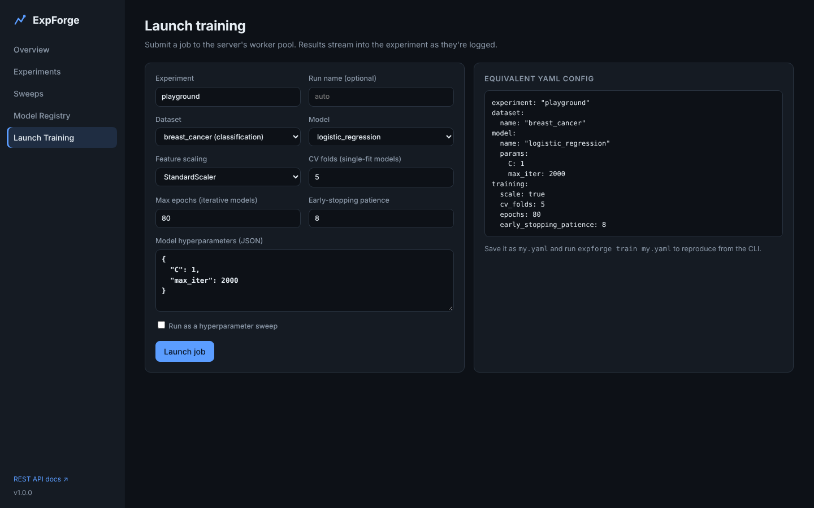

# ExpForge: ML Experimentation Platform

**Train models, track experiments, run hyperparameter sweeps, evaluate and compare models, and promote the best one to a served model registry, all from one self-hosted platform.**

     

ExpForge is a lightweight, self-hosted alternative to MLflow / Weights & Biases. A **Python SDK** logs params, metric curves, evaluation reports and model artifacts to a **FastAPI tracking server**. A **config-driven training engine** runs single experiments or grid/random **hyperparameter sweeps**. A **web dashboard** lets you compare runs, inspect ROC/PR/calibration curves and confusion matrices, and promote models through **Staging → Production**. The Production model is served live at a REST prediction endpoint.



---

## Features

| Area | What you get |
|---|---|
| **Experiment tracking** | Experiments → runs hierarchy; params, tags, notes, per-step metric time series, summary metrics, system info (Python, platform, git commit + dirty flag) and **dataset fingerprints** for data lineage |
| **Python SDK** | `expforge.init()` context manager, batched metric buffering, retry with exponential backoff, auto `failed`/`killed` status on exceptions or Ctrl-C, `log_model()` artifact upload with SHA-256 checksums |
| **Training engine** | YAML-configured; 8 datasets (built-ins, synthetic generators, or **your own CSV** with auto one-hot encoding) × 11 model families; stratified train/val/test splits; k-fold CV; feature-scaling pipelines |
| **Learning curves** | Epoch-by-epoch training (`partial_fit`) with **early stopping + best-checkpoint restore** for neural nets/SGD; per-iteration curves for boosting recovered from staged predictions |
| **Hyperparameter sweeps** | Grid and random search over dotted config paths with `int` / `uniform` / `loguniform` / `choice` distributions, duplicate-trial elimination, best-so-far tracking, and a shared dataset cache across trials |
| **Model evaluation** | 25+ metrics (accuracy, F1, MCC, Cohen's κ, ROC-AUC, PR-AUC, log-loss, Brier, R², RMSE, MAPE…), confusion matrix, one-vs-rest ROC & PR curves, **calibration curve + ECE**, decision-threshold analysis, residual analysis, feature importance (impurity / coefficients / permutation), **inference latency + model size profiling**, overfitting gap |
| **Comparison** | Side-by-side run diff that highlights differing hyperparameters and the best value per metric (direction-aware), overlaid learning curves, leaderboards, a param-vs-metric scatter and a **parallel-coordinates plot** |
| **Model registry & serving** | Versioned models with lifecycle stages (only one version can hold Production; the previous one is auto-archived), metric snapshots, and `POST /api/models/{name}/predict` backed by a thread-safe LRU model cache |
| **Training jobs** | Launch training or sweeps from the UI; jobs run on a background worker pool and stream results into the dashboard |
| **Ops** | 29 REST endpoints with auto-generated OpenAPI docs, SQLite (WAL mode) or Postgres, multi-stage non-root Docker image, docker-compose stack, GitHub Actions CI (lint, tests on 3 Python versions, CLI smoke test, Docker health check) |

## Architecture



Everything flows through the SDK. The built-in trainer uses the same public client that a user's PyTorch or NumPy loop would, so the platform dogfoods its own API.

```
expforge/
├── sdk.py                 # Client, Run, HttpTransport (batching, retries, context manager)
├── cli.py                 # expforge server | train | demo | runs | catalog
├── server/
│   ├── app.py             # FastAPI app factory, all routes, job worker, model cache
│   ├── db.py              # SQLAlchemy 2.0 models (7 tables) + engine setup
│   └── schemas.py         # Pydantic v2 request/response models
├── training/
│   ├── config.py          # YAML schema, defaults, validation
│   ├── datasets.py        # dataset registry + fingerprinting
│   ├── models.py          # model zoo (11 families × classification/regression)
│   ├── trainer.py         # training strategies, evaluation, artifact logging
│   └── sweep.py           # search-space sampling, grid/random sweeps
├── evaluation/metrics.py  # metrics + chart-ready payloads
└── static/                # single-page dashboard (no build step)
configs/                   # 9 example experiments incl. 2 sweeps
examples/                  # custom NumPy training loop, client API tour
tests/                     # 35 tests: API, SDK, metrics, training, sweeps, registry, jobs
```

## Quickstart

```bash
git clone https://github.com/<you>/expforge && cd expforge
pip install -e ".[dev]"

expforge demo          # trains 9 example configs (28 runs, 2 sweeps, 3 registered models)
expforge server        # → http://127.0.0.1:8000/ui    API docs → http://127.0.0.1:8000/docs
```

Or with Docker (Postgres-backed):

```bash
docker compose up --build
```

## Usage

### 1. Track any training loop

```python
import expforge

with expforge.init(experiment="churn", params={"lr": 3e-4, "layers": 4}) as run:
    for epoch in range(50):
        train_loss, val_loss, val_acc = train_one_epoch(...)
        run.log({"train_loss": train_loss, "val_loss": val_loss, "val_acc": val_acc}, step=epoch)
    run.log_summary({"test_acc": evaluate(model)})
    run.log_model(model)        # uploaded, checksummed, registrable
```

See [`examples/custom_training_loop.py`](examples/custom_training_loop.py) for a from-scratch NumPy model tracked end-to-end.

### 2. Train from a config

```yaml
# configs/03_breast_cancer_gbm.yaml
experiment: breast-cancer-diagnosis
name: gbm-lr0.05
dataset: {name: breast_cancer, test_size: 0.2, val_size: 0.2, seed: 42}
model:
  name: gradient_boosting
  params: {n_estimators: 250, learning_rate: 0.05, max_depth: 3, subsample: 0.8}
training: {scale: false, cv_folds: 0}
register: {name: cancer-classifier, stage: Production}
```

```bash
expforge train configs/03_breast_cancer_gbm.yaml
```

### 3. Run a hyperparameter sweep

```yaml
sweep:
  strategy: random          # or grid
  n_trials: 20
  objective: val_f1_macro   # any summary metric
  direction: maximize
  search_space:
    model.params.n_estimators: [50, 100, 200]
    model.params.learning_rate: {type: loguniform, low: 0.01, high: 0.5}
    model.params.max_depth: {type: int, low: 1, high: 5}
    model.params.subsample: {type: uniform, low: 0.5, high: 1.0}
```

Each trial is a fully tracked run. The best one can be auto-registered with the `register:` block.

### 4. Serve the Production model

```bash
curl -X POST localhost:8000/api/models/cancer-classifier/predict \
     -H 'Content-Type: application/json' \
     -d '{"instances": [[17.9, 10.4, 122.8, ...]], "return_proba": true}'
# {"model": "cancer-classifier", "version": 2, "predictions": [0], "probabilities": [[0.97, 0.03]]}
```

### Built-in catalog

| Datasets | Models |
|---|---|
| `breast_cancer`, `wine`, `iris`, `digits`, `diabetes`, `synthetic_classification`, `synthetic_regression`, `csv` (bring your own) | `logistic_regression`, `ridge`, `decision_tree`, `random_forest`, `extra_trees`, `gradient_boosting`*, `hist_gradient_boosting`, `svm`, `knn`, `mlp`*, `sgd`* |

\* produces per-epoch or per-iteration learning curves.

## Dashboard

| Experiment view: leaderboard, param scatter, parallel coordinates | Run view: learning curves with early stopping |
|---|---|
|  |  |
| **Evaluation: confusion matrix, ROC, PR, calibration, thresholds** | **Run comparison: param diff, metric bars, overlaid curves** |
|  |  |
| **Sweeps: trial scatter + best-so-far** | **Model registry with stage management + live prediction** |
|  |  |
| **Regression analysis: predicted vs actual, residuals** | **Launch training jobs from the browser** |
|  |  |

## REST API (selected)

| Method | Path | Purpose |
|---|---|---|
| `POST` | `/api/runs` | start a run (auto-creates experiment) |
| `PATCH` | `/api/runs/{id}` | update status / merge params, summary, evaluation |
| `POST` | `/api/runs/{id}/metrics` | batch-log metric points |
| `POST` | `/api/runs/{id}/artifacts` | upload artifact (streamed, SHA-256) |
| `POST` | `/api/compare` | diff 2–20 runs |
| `GET` | `/api/experiments/{id}/leaderboard` | rank runs by any metric |
| `POST` | `/api/sweeps` · `GET` `/api/sweeps` | sweep lifecycle |
| `POST` | `/api/models` | register a run's model as a new version |
| `PATCH` | `/api/models/{name}/versions/{v}` | stage transition |
| `POST` | `/api/models/{name}/predict` | online inference |
| `POST` | `/api/jobs` | queue a training job / sweep |

Full interactive docs are at `/docs` (OpenAPI).

## Design decisions

- **The SDK is the only write path.** The trainer, the CLI and background jobs all log through `expforge.Client`, so the public API gets exercised by every run. Transport is pluggable: in tests the SDK talks to FastAPI's `TestClient`, so the whole system runs in-process with no network.
- **Metric batching.** `Run.log()` buffers points and flushes every 50 values (and on finish), so tight training loops make a handful of HTTP calls per run instead of one per metric. NaN/inf are dropped client-side because JSON can't carry them.
- **JSON columns are merged, not replaced**, on `PATCH`. A run can log its summary incrementally from different stages without overwriting earlier fields.
- **Chart-ready evaluation payloads.** Curves are downsampled to ≤120 points at logging time, which keeps run documents small and the dashboard fast.
- **Best-checkpoint restore.** Iterative models deep-copy the estimator at the best validation loss, so early stopping returns the best model, not the last one.
- **Reproducibility.** Every run stores its fully resolved config, seed, dataset fingerprint (SHA-256 of X/y), git commit and library versions. The same config and seed give identical metrics, and there's a test for it.
- **Registry invariants.** Promoting a version to Production auto-archives the previous Production version, so `/predict` is never ambiguous.
- **SQLite in WAL mode** lets the dashboard read while training jobs write; set `EXPFORGE_DB_URL` to use Postgres instead.

## Testing

```bash
make test     # 35 tests, 85% coverage
make lint     # ruff
```

The tests cover API CRUD and cascades, JSON-merge semantics, artifact checksums and path-traversal stripping, SDK failure handling and buffering, metric correctness against scikit-learn, ECE behaviour, early stopping, staged boosting curves, seed reproducibility, grid/random trial generation, sweep → registry → prediction end-to-end, stage transitions, and background jobs.

## Roadmap

- PyTorch Lightning / Keras callbacks for zero-code logging
- Successive-halving / Bayesian (TPE) sweep strategies
- S3 / GCS artifact backends
- Auth tokens + per-project permissions
- Data drift monitoring on the prediction endpoint

## Security note

Model artifacts are serialized with joblib (pickle). Only load stores you trust, and keep the server on a trusted network or put it behind auth.

## License

MIT
